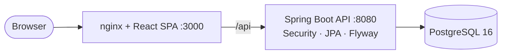

# Helpdesk — Multi-Tenant Ticketing System

A web application where multiple organizations manage support tickets in complete isolation from each other. It supports Org Admins, Support Agents and Customers, and includes ticket assignment, a status workflow, internal notes, an audit history, and search with pagination.

> **Status:** v1.0 — Phases 0–8 of the [plan](docs/08-implementation-plan.md) are implemented and verified.
> What was built, the deviations from the design and the test evidence are in [10 — Implementation Notes](docs/10-implementation-notes.md).

---

## Documentation

| # | Document | What's inside |
|---|---|---|
| 01 | [Requirements](docs/01-requirements.md) | Numbered functional and non-functional requirements, business rules, assumptions, out of scope |
| 02 | [Architecture](docs/02-architecture.md) | C4 diagrams, components, request lifecycle, cross-cutting concerns, tech stack, deployment |
| 03 | [Domain & Data Model](docs/03-domain-and-data-model.md) | ERD, ticket state machine, full PostgreSQL DDL, JPA mapping |
| 04 | [API Design](docs/04-api-design.md) | Endpoint catalogue, request and response contracts, error model, role matrix |
| 05 | [Security & Multi-Tenancy](docs/05-security-and-multitenancy.md) | Threat model, four-layer tenant isolation, JWT design, security checklist |
| 06 | [Frontend Design](docs/06-frontend-design.md) | Routes, wireframes, structure, data layer, error handling |
| 07 | [Testing Strategy](docs/07-testing-strategy.md) | Test pyramid, key unit tests, the tenant isolation suite |
| 08 | [Implementation Plan](docs/08-implementation-plan.md) | Phases 0–9 with tasks, exit criteria, milestones, risks, traceability |
| 09 | [Architecture Decisions](docs/09-architecture-decisions.md) | ADR-001 … ADR-010 |
| 10 | [Implementation Notes](docs/10-implementation-notes.md) | As-built summary, deviations, verification evidence, requirement → test map, known limitations |
| 11 | [User Guide](docs/11-user-guide.md) | Screenshot walkthrough for admin, agent and customer, tenant isolation in the UI, Swagger UI |
| — | [OpenAPI spec](docs/openapi.yaml) · [Postman collection](postman/helpdesk.postman_collection.json) | Machine-readable API contract and a runnable end-to-end collection |
| — | [Backend README](backend/README.md) · [Frontend README](frontend/README.md) | Module-level structure, conventions and commands |

## Screenshots

| Agent — ticket list | Agent — ticket detail (internal note in yellow) |
|---|---|
|  |  |
| **Customer — own tickets only** | **Globex admin opening an Acme ticket → not found** |
|  |  |

All screens, role by role: [11 — User Guide](docs/11-user-guide.md).

## Architecture at a Glance



**Tenant isolation:** the org ID comes only from the JWT, and the user is reloaded from the database on every request. Every query is scoped by org. ArchUnit stops code from calling the unscoped repository methods. Composite foreign keys in the database make cross-tenant references impossible. A dedicated integration suite (`TenantIsolationIT`, 16 cases) proves all of it.

## Tech Stack
Java 21 · Spring Boot 3.5 · Spring Security (JWT resource server) · Spring Data JPA · PostgreSQL 16 · Flyway · springdoc-openapi · MapStruct · JUnit 5 · Mockito · Testcontainers · ArchUnit · JaCoCo · React 18 · TypeScript · Vite · MUI 6 · TanStack Query · React Hook Form + Zod

---

## Setup on Any Machine

Pick **one** of the two options:

| | Option A — Docker | Option B — Manual |
|---|---|---|
| Best for | Trying the app, demos, reviewers | Development (fast reload, debugging) |
| You install | Docker only | JDK 21, Node.js 20+, PostgreSQL 16 |
| Web app URL | http://localhost:3000 | http://localhost:5173 |
| Commands to start | 1 | 3 (database, backend, frontend) |

### Step 1 — Get the code

```bash
git clone <repository-url> helpdesk
cd helpdesk
```

No git remote? Copy the project folder instead, but leave out `frontend/node_modules`, `frontend/dist` and `backend/target` (they are rebuilt automatically).

**Required free ports:** `3000` (web, Docker only), `5173` (web, manual only), `8080` (API), `5432` (PostgreSQL).

---

### Option A — Docker (recommended)

**A1. Install Docker**

| OS | What to install |
|---|---|
| Windows 10/11 | [Docker Desktop](https://www.docker.com/products/docker-desktop/) with the WSL 2 backend |
| macOS (Intel or Apple silicon) | [Docker Desktop](https://www.docker.com/products/docker-desktop/) |
| Linux | Docker Engine + the Compose plugin (`sudo apt install docker.io docker-compose-plugin` on Ubuntu, or follow docs.docker.com) |

Start Docker Desktop and check it works:
```bash
docker --version
docker compose version
```

**A2. Create the `.env` file** (optional for a local demo, required for any shared or real use)
```bash
cp .env.example .env              # Windows PowerShell: Copy-Item .env.example .env
openssl rand -base64 48           # copy the output…
```
…and paste it into `.env` after `JWT_SECRET=`. Any random string of at least 32 characters works if `openssl` isn't installed. Without a `.env`, Docker Compose falls back to a dev-only placeholder secret, so never skip this step outside your own machine.

**A3. Build and start**
```bash
docker compose up --build
```
The first run downloads images and dependencies (a few minutes). It's ready when the backend log shows `Started HelpdeskApplication` (on the very first start also `Seeded demo organization 'globex'`) and the `web` container is running.

**A4. Open the app**

| URL | What |
|---|---|
| http://localhost:3000 | Web app |
| http://localhost:8080/swagger-ui.html | API docs (Swagger UI) |
| http://localhost:8080/actuator/health | Health check — should return `{"status":"UP",...}` |

Log in with organization `acme`, email `admin@acme.test`, password `Password123!` (see [Demo accounts](#demo-accounts-demo-profile)).

**A5. Day-to-day commands**

| Task | Command |
|---|---|
| Run in the background | `docker compose up -d --build` |
| Watch logs | `docker compose logs -f backend` |
| Stop (keep data) | `docker compose down` |
| Stop and delete all data | `docker compose down -v` |
| Rebuild after code changes | `docker compose up --build` |
| Use a different web port | change `"3000:80"` in `docker-compose.yml`, e.g. `"8081:80"` |

---

### Option B — Manual setup (without Docker)

**B1. Install the prerequisites**

| Tool | Version | Download / install | Check |
|---|---|---|---|
| JDK | **21** | [Eclipse Temurin 21](https://adoptium.net/) (Windows/macOS installers), `sudo apt install openjdk-21-jdk` (Ubuntu), `brew install --cask temurin@21` (macOS) | `java -version` → 21 |
| Node.js | **20 or newer** | [nodejs.org](https://nodejs.org/) LTS, or `nvm install 20` | `node -v`, `npm -v` |
| PostgreSQL | **16** | [postgresql.org/download](https://www.postgresql.org/download/) (Windows/macOS installers include `pg_trgm`), `sudo apt install postgresql-16` (Ubuntu), `brew install postgresql@16` (macOS) | `psql --version` |

Maven does **not** need to be installed — the project's Maven wrapper (`mvnw` / `mvnw.cmd`) downloads it on first use.
Shortcut: if Docker is available, you can skip installing PostgreSQL and run only the database container with `docker compose up -d db`, then go straight to B3.

**B2. Create the database** — open a PostgreSQL superuser shell (`psql -U postgres`, or on Linux `sudo -u postgres psql`) and run:
```sql
CREATE USER helpdesk WITH PASSWORD 'helpdesk';
CREATE DATABASE helpdesk OWNER helpdesk;
\c helpdesk
CREATE EXTENSION IF NOT EXISTS pg_trgm;   -- needed for ticket search; requires superuser
\q
```
You don't create any tables — the backend creates them on first start (Flyway migrations).

**B3. Start the backend** (terminal 1, from the project folder)

macOS / Linux:
```bash
cd backend
export DB_URL=jdbc:postgresql://localhost:5432/helpdesk
export DB_USERNAME=helpdesk
export DB_PASSWORD=helpdesk
export JWT_SECRET=$(openssl rand -base64 48)
chmod +x mvnw                                        # first time only
./mvnw spring-boot:run -Dspring-boot.run.profiles=dev,demo
```

Windows (PowerShell):
```powershell
cd backend
$env:DB_URL = "jdbc:postgresql://localhost:5432/helpdesk"
$env:DB_USERNAME = "helpdesk"
$env:DB_PASSWORD = "helpdesk"
$env:JWT_SECRET = "replace-with-a-random-string-of-at-least-32-characters"
.\mvnw.cmd spring-boot:run "-Dspring-boot.run.profiles=dev,demo"
```

The first start downloads Maven and all dependencies (a few minutes). It's ready when the log shows `Started HelpdeskApplication` (on the very first start it then seeds the demo data: `Seeded demo organization 'globex'`). Check http://localhost:8080/actuator/health.

**B4. Start the frontend** (terminal 2, from the project folder)
```bash
cd frontend
npm install          # first time, and after dependency changes
npm run dev
```

**B5. Open the app** at **http://localhost:5173**. The Vite dev server forwards `/api` calls to the backend on port 8080, so no extra configuration is needed. Swagger UI is at http://localhost:8080/swagger-ui.html.

Stop either process with `Ctrl+C`. The data stays in your PostgreSQL database.

---

### Step 2 — Verify the installation

| Check | How | Expected |
|---|---|---|
| API is up | open http://localhost:8080/actuator/health | `{"status":"UP",...}` |
| Login works | sign in as `acme` / `admin@acme.test` / `Password123!` | Ticket list with 25 tickets |
| Tenant isolation | as an Acme agent open a ticket, copy its URL; sign in as `admin@globex.test` (org `globex`) and open that URL | "Ticket not found" |
| Automated tests (optional) | see [Running Tests](#running-tests) | all green |

### Troubleshooting

| Symptom | Cause / fix |
|---|---|
| `JWT_SECRET must be set and at least 32 bytes long` | Set `JWT_SECRET` — in `.env` (Docker) or as an environment variable (manual). |
| `Connection refused` / `password authentication failed` | PostgreSQL isn't running, or `DB_URL`, `DB_USERNAME`, `DB_PASSWORD` don't match the database you created. |
| `extension "pg_trgm" is not available` / `permission denied to create extension` | Run `CREATE EXTENSION pg_trgm;` as a superuser in the `helpdesk` database (step B2). On Linux install `postgresql-contrib` if it's missing. |
| `Port 8080 / 3000 / 5432 / 5173 is already in use` | Stop the other program, or change the port (`docker-compose.yml` for Docker; `SERVER_PORT=8081` for the backend; `npm run dev -- --port 5174` for the frontend — the proxy still targets 8080). |
| `./mvnw: Permission denied` | `chmod +x backend/mvnw` |
| `release version 21 not supported` / wrong Java | `java -version` must report 21. Set `JAVA_HOME` to the JDK 21 folder. |
| Login says "incorrect" on a fresh install | The `demo` profile wasn't active, so no demo users exist. Start with profiles `dev,demo` (manual) or keep the default `SPRING_PROFILES_ACTIVE` (Docker). Or register a new organization on the sign-in page. |
| Web app loads but every action fails | The backend isn't running or isn't on port 8080. |
| Docker: `Cannot connect to the Docker daemon` | Start Docker Desktop and wait until it reports "running". |
| Windows: `mvnw.cmd` fails with line-ending errors | Clone with `git config --global core.autocrlf input`, or re-checkout the file. |

### Deploying for other people (beyond a local machine)

- Use a managed or dedicated PostgreSQL 16 and point `DB_URL`, `DB_USERNAME`, `DB_PASSWORD` at it (enable `pg_trgm` once).
- Set a strong, private `JWT_SECRET` and keep it out of git.
- Use `SPRING_PROFILES_ACTIVE=prod` (add `demo` only if you want the sample data).
- Put HTTPS in front of the `web` container (a reverse proxy or your cloud's load balancer); the browser only ever talks to the web container, which forwards `/api` to the backend.
- Optionally hide the API docs with `SWAGGER_UI_ENABLED=false`, and don't publish port `5432` (remove the `ports` entry of `db` in `docker-compose.yml`).

### Demo accounts (`demo` profile)
All demo accounts use the password `Password123!`.

| Org slug | Role | Email |
|---|---|---|
| `acme` | Org Admin | admin@acme.test |
| `acme` | Agent | agent1@acme.test, agent2@acme.test |
| `acme` | Customer | customer1@acme.test, customer2@acme.test, customer3@acme.test |
| `globex` | Org Admin | admin@globex.test |
| `globex` | Agent | agent1@globex.test, agent2@globex.test |
| `globex` | Customer | customer1@globex.test, customer2@globex.test, customer3@globex.test |

Each organization has 25 tickets in mixed states (open, assigned, in progress, on hold, resolved, closed), with public replies, internal notes and history. The seeder is idempotent: an organization that already exists is skipped.

**Things to try:** log in as `agent1@acme.test` and open a ticket. You see internal notes (yellow) and every action. Log in as `customer1@acme.test`: only your own tickets, no internal notes, and only the close/reopen transitions. Log in as `agent1@globex.test` and paste an Acme ticket URL: you get "not found".

### Environment variables
| Variable | Default | Description |
|---|---|---|
| `DB_URL` | `jdbc:postgresql://localhost:5432/helpdesk` | JDBC URL of the database |
| `DB_USERNAME` / `DB_PASSWORD` | `helpdesk` / `helpdesk` | Database credentials |
| `JWT_SECRET` | *(required, ≥ 32 bytes)* | Signs login tokens. The app refuses to start without it |
| `JWT_TTL_MINUTES` | `60` | How long a login stays valid |
| `CORS_ALLOWED_ORIGINS` | `http://localhost:5173` in `dev`, empty otherwise | Only needed when the web app runs on another origin |
| `SPRING_PROFILES_ACTIVE` | `dev` (manual) · `prod,demo` (Docker) | `dev` debug logs + CORS for Vite · `demo` seed data · `prod` JSON logs |
| `SERVER_PORT` | `8080` | Backend port |
| `SWAGGER_UI_ENABLED` | `true` | Set to `false` (with `prod`) to hide Swagger UI |

With Docker these go in `.env` (template: [`.env.example`](.env.example)). For the manual setup, set them in the terminal before starting the backend — `./mvnw spring-boot:run` does **not** read `.env`. Every other setting has a default in [`backend/src/main/resources/application.yml`](backend/src/main/resources/application.yml).

## Running Tests

```bash
cd backend && ./mvnw verify   # 202 unit/web-slice/ArchUnit tests + 35 integration tests + JaCoCo gate
cd frontend && npm run lint && npm run typecheck && npm test && npm run build
npx newman run postman/helpdesk.postman_collection.json      # against a running backend with the demo profile
```

The integration tests (`*IT`) start `postgres:16-alpine` with **Testcontainers**, so they need Docker. Without Docker, point them at any empty PostgreSQL 16 database:

```bash
IT_DB_URL=jdbc:postgresql://localhost:5432/helpdesk_it IT_DB_USERNAME=helpdesk IT_DB_PASSWORD=helpdesk ./mvnw verify
```

If neither is available, the ITs are skipped rather than failed. Coverage reports are written to `backend/target/site/jacoco/index.html`.

## Project Structure

```
.
├── docker-compose.yml          db + backend + web
├── .env.example                environment template (copy to .env)
├── .github/workflows/ci.yml    backend verify, frontend checks, docker build
├── docs/                       design docs 01–10, openapi.yaml
├── postman/                    helpdesk.postman_collection.json
├── backend/                    Spring Boot API (see backend/README.md)
│   ├── Dockerfile              multi-stage Maven → JRE 21, non-root, layered jar
│   └── src/main/java/com/helpdesk/
│       ├── common/  config/  security/
│       ├── auth/  organization/  user/
│       ├── ticket/{domain,repository,service,web}
│       ├── comment/  history/  seed/
└── frontend/                   React SPA (see frontend/README.md)
    ├── Dockerfile, nginx.conf  node build → nginx; proxies /api to the backend
    └── src/{api,auth,features,components,utils}
```

## Key Design Decisions
- **Shared schema with an `organization_id` discriminator**, enforced in four layers: token → service → repository → database (ADR-001, doc 05 §2).
- **404, not 403**, for anything outside the caller's visibility, which blocks ID enumeration (ADR-004).
- **One policy class** (`TicketAccessPolicy`) decides visibility and permissions. The API returns `permissions` and `allowedTransitions`, so the UI never re-implements the rules.
- **The state machine is pure Java**, tested exhaustively (all 25 status pairs × role).
- **History is written in the same transaction** as the change it records (ADR-009). Feature packages stay free of cycles through small ports (ADR-010).
- **RFC 7807 errors** with stable `code` values (ADR-007). Optimistic locking on tickets and users.

## Known Limitations
See [10 — Implementation Notes §5](docs/10-implementation-notes.md#5-known-limitations). In short: no server-side logout or refresh tokens yet, no login rate limiting, a theoretical race on the "last admin" rule, and React Router 6 advisories (the fix requires v7). Email notifications, attachments, SLAs and the other [out-of-scope items](docs/01-requirements.md#7-out-of-scope-v1) are not included.
