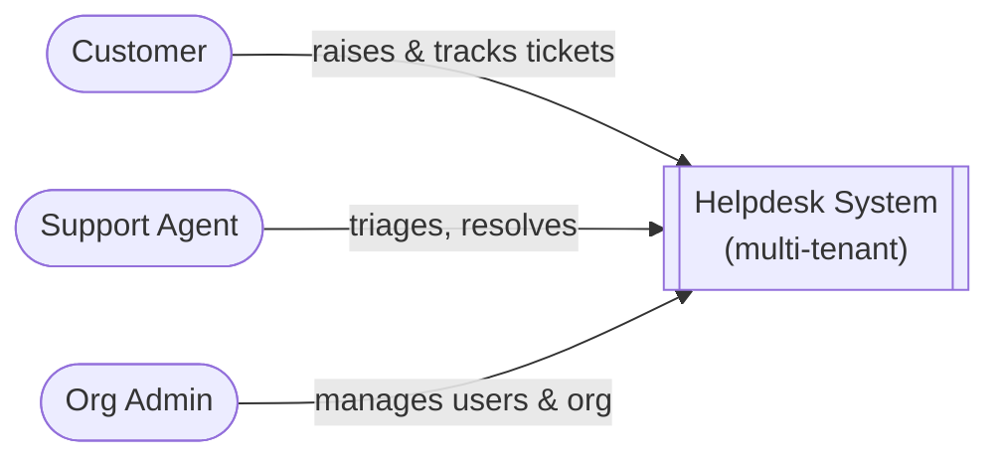
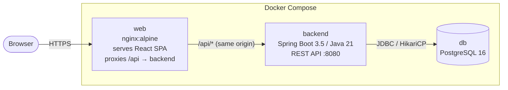
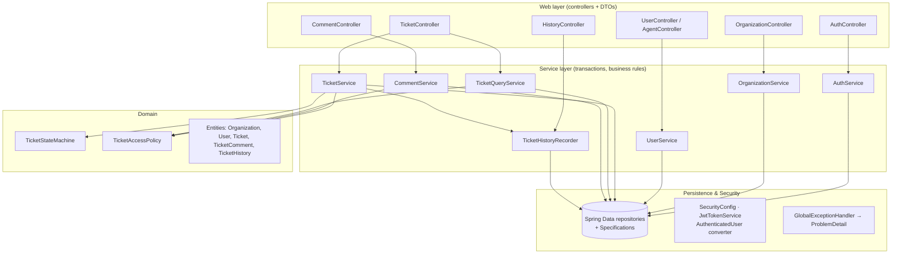
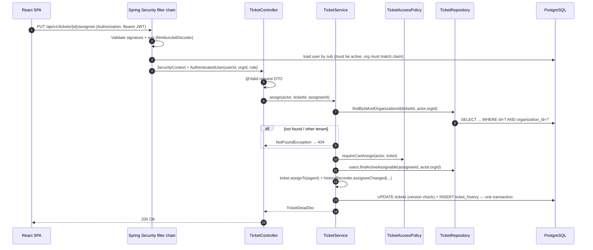

# 02 — System Architecture

> Style: **Modular monolith** (Spring Boot), stateless REST API, single-page frontend, shared PostgreSQL database
> Related: [03 Domain & Data](03-domain-and-data-model.md) · [04 API](04-api-design.md) · [05 Security & Tenancy](05-security-and-multitenancy.md) · [09 ADRs](09-architecture-decisions.md)

---

## 1. Architectural Drivers

| Driver | Consequence for the design |
|---|---|
| **Strict tenant isolation** (the top risk) | Every tenant-owned row carries `organization_id`. The tenant always comes from the token. Every query is scoped by tenant. Composite foreign keys make cross-tenant links impossible in the database itself. A dedicated test suite checks all of this |
| Role-based visibility (internal notes, customer scope) | Authorization lives in one central `TicketAccessPolicy`, not scattered across controllers |
| Small team, short timeline, assessment-style deliverable | A monolith rather than microservices. Mainstream libraries, minimal custom infrastructure |
| Easy to review and run | Docker Compose with one command, seed data, Swagger UI |

## 2. System Context (C4 Level 1)



There are no external systems in v1. Email/SMTP and object storage for attachments are Phase 9 integration points.

## 3. Containers (C4 Level 2)



| Container | Technology | Responsibility |
|---|---|---|
| **web** | React 18, TypeScript, Vite, served by nginx | UI. Holds the JWT in memory and sessionStorage. Talks only to `/api` |
| **backend** | Spring Boot 3.5, Spring Security (OAuth2 Resource Server for JWT), Spring Data JPA, Flyway, springdoc | Business logic, authentication and authorization, validation, persistence |
| **db** | PostgreSQL 16 | System of record. The schema is managed only by Flyway migrations |

Because nginx serves the frontend and proxies `/api` from the same origin, production needs no CORS setup. CORS is enabled only for the Vite dev server (`localhost:5173`).

## 4. Backend Components (C4 Level 3)



### 4.1 Layering rules (checked by ArchUnit)
1. Controllers depend only on services and DTOs. They never touch repositories or entities directly, and they never return entities.
2. Services own transactions (`@Transactional`) and take the `AuthenticatedUser actor` as an **explicit parameter**. There is no hidden ThreadLocal tenant. This makes tenant scoping visible in every method signature and easy to verify in unit tests with Mockito.
3. Repositories for tenant-owned data only offer methods that take `organizationId`. ArchUnit stops services from calling the inherited `findById`/`findAll` on those repositories.
4. Feature packages may not reach into another feature's internals. They talk only through that feature's public service.

### 4.2 Package structure (package-by-feature)

> As built, `Role`, `AuthenticatedUser` and `PrincipalLoader` live in `security/`, `CommentVisibility` lives in `ticket/domain/`, and `ticket/service/` also holds the `TicketAuditTrail` and `StatusChangeCommentWriter` ports. See [ADR-010](09-architecture-decisions.md#adr-010--dependency-inversion-between-ticket-history-and-comment) and [10 — Implementation Notes](10-implementation-notes.md).

```
backend/src/main/java/com/helpdesk/
├── HelpdeskApplication.java
├── common/
│   ├── error/          ApiException, ErrorCode, GlobalExceptionHandler
│   ├── persistence/    BaseEntity (id, createdAt, updatedAt), TenantOwnedEntity (organizationId)
│   └── web/            PageResponse, SortSanitizer
├── config/             OpenApiConfig, WebConfig (CORS), ClockConfig, JpaAuditingConfig
├── security/           SecurityConfig, JwtTokenService, AuthenticatedUser,
│                       AuthenticatedUserConverter, @CurrentUser, ProblemAuthEntryPoint, ProblemAccessDeniedHandler
├── auth/               AuthController, AuthService, dto/
├── organization/       Organization, OrganizationRepository, OrganizationService, OrganizationController, dto/
├── user/               User, Role, UserRepository, UserService, UserController, AgentController, dto/, UserMapper
├── ticket/
│   ├── domain/         Ticket, TicketStatus, TicketPriority, TicketStateMachine, TicketAccessPolicy
│   ├── repository/     TicketRepository, TicketSpecifications
│   ├── service/        TicketService (commands), TicketQueryService (search/read)
│   └── web/            TicketController, dto/, TicketMapper
├── comment/            TicketComment, CommentVisibility, CommentRepository, CommentService, CommentController, dto/
├── history/            TicketHistory, HistoryEventType, TicketHistoryRepository, TicketHistoryRecorder, HistoryController
└── seed/               DemoDataSeeder (@Profile("demo"))
```

## 5. Request Lifecycle



## 6. Cross-Cutting Concerns

| Concern | Approach |
|---|---|
| **Validation** | Jakarta Bean Validation on request DTOs (`@Valid`). Business rules are checked in services and raise `ApiException(ErrorCode)` |
| **Errors** | One `@RestControllerAdvice` turns every exception into RFC 7807 `ProblemDetail` with `code`, `traceId` and `errors[]`. Unexpected errors → `500` with a generic message, and the full stack trace goes only to the log |
| **Transactions** | Service methods are `@Transactional`. Reads use `readOnly = true`. History is written in the same transaction as the change it records |
| **Concurrency** | JPA `@Version` on `Ticket` and `User`. `ObjectOptimisticLockingFailureException` → `409 CONCURRENT_MODIFICATION`. Ticket numbers come from an atomic `UPDATE … RETURNING` on the org's counter |
| **Auditing** | Spring Data JPA auditing fills `createdAt`/`updatedAt`. Business history lives in `ticket_history` |
| **Time** | `Instant` everywhere, stored as `TIMESTAMPTZ`, serialized as ISO-8601 UTC. An injectable `Clock` makes time testable |
| **IDs** | UUID primary keys (unguessable) plus a per-org human-readable ticket `number` |
| **Mapping** | MapStruct between entities and DTOs, so entities never leak out of the service layer |
| **Logging** | SLF4J + Logback, JSON in the `prod` profile. A filter puts `traceId`, `orgId` and `userId` into the MDC. Passwords and tokens are never logged |
| **API docs** | springdoc-openapi: `/v3/api-docs` and `/swagger-ui.html`, with JWT bearer authentication configured |
| **Health** | Spring Boot Actuator, exposing only `health` and `info` |
| **Configuration** | `application.yml` plus environment variables: `DB_URL`, `DB_USERNAME`, `DB_PASSWORD`, `JWT_SECRET`, `JWT_TTL_MINUTES`, `CORS_ALLOWED_ORIGINS`, `SPRING_PROFILES_ACTIVE` |

## 7. Technology Stack

| Layer | Choice | Why |
|---|---|---|
| Language | **Java 21 (LTS)** | Meets the "17 or later" requirement. Gives records, pattern matching and virtual threads |
| Framework | **Spring Boot 3.5.x** | Required by the client. Mature support from springdoc, MapStruct and Testcontainers |
| Security | Spring Security 6 + `spring-boot-starter-oauth2-resource-server` | Standard JWT validation with no hand-written crypto filters |
| Persistence | Spring Data JPA (Hibernate 6) + **PostgreSQL 16** + **Flyway** | Relational data with strong integrity constraints (composite foreign keys) |
| Build | Maven (wrapper committed) | Widely known, works cleanly with JaCoCo |
| Mapping & boilerplate | MapStruct. Lombok only for entities, if at all (records are used for DTOs) | — |
| Docs | springdoc-openapi 2.x | Generates Swagger UI from the code itself |
| Tests | JUnit 5, Mockito, AssertJ, Spring Boot Test, **Testcontainers** (Postgres), ArchUnit, JaCoCo | Required by the client, plus real-database integration tests |
| Frontend | React 18, TypeScript, Vite, React Router, TanStack Query, React Hook Form + Zod, MUI, Axios | Fast to build, type-safe, and familiar to most reviewers |
| Runtime | Docker Compose (db, backend, web) | One-command start |
| CI | GitHub Actions: build, test and coverage gate | — |

## 8. Deployment View

```
docker compose up --build
 ├─ db       postgres:16-alpine        :5432   volume: pgdata
 ├─ backend  eclipse-temurin:21-jre     :8080   (multi-stage Maven build; waits for db healthcheck)
 └─ web      nginx:alpine               :3000→80 (static SPA; location /api → http://backend:8080)
```

The backend runs Flyway migrations on startup. The `demo` profile seeds two organizations so reviewers can see tenant isolation right away.

## 9. Repository Layout

```
helpdesk/
├── README.md
├── docker-compose.yml
├── .github/workflows/ci.yml
├── docs/                         ← this documentation set
├── backend/
│   ├── pom.xml, mvnw
│   ├── Dockerfile
│   └── src/{main,test}/...
├── frontend/
│   ├── package.json, vite.config.ts
│   ├── Dockerfile, nginx.conf
│   └── src/...
└── postman/helpdesk.postman_collection.json
```

## 10. Scalability & Evolution

- **Stateless backend**: you can scale it horizontally behind a load balancer with no sticky sessions.
- **Database growth**: all hot queries start with `organization_id`. That keeps the indexes selective per tenant and leaves a clean path to partition by `organization_id` or to move a very large tenant into its own database later.
- **Defense in depth**: PostgreSQL Row-Level Security (Phase 9) can be added later without changing any APIs.
- **Search**: `ILIKE` plus `pg_trgm` GIN indexes is enough for v1. The next step is Postgres full-text search, then a dedicated search engine.
- **Notifications**: the history recorder is the natural place to publish domain events (`TicketAssigned` and so on) to a future notifier.
