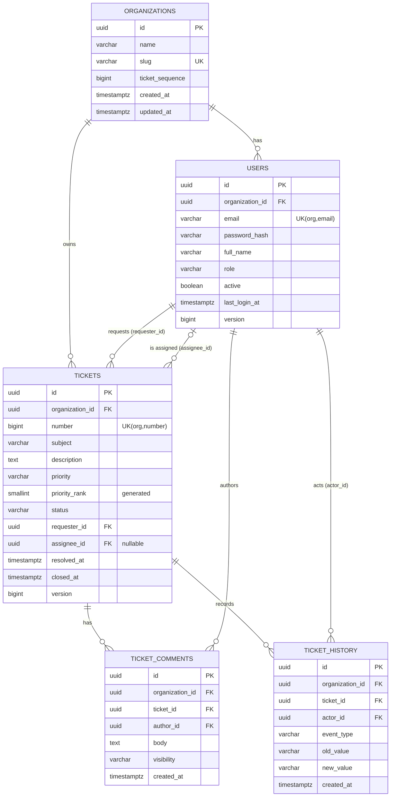
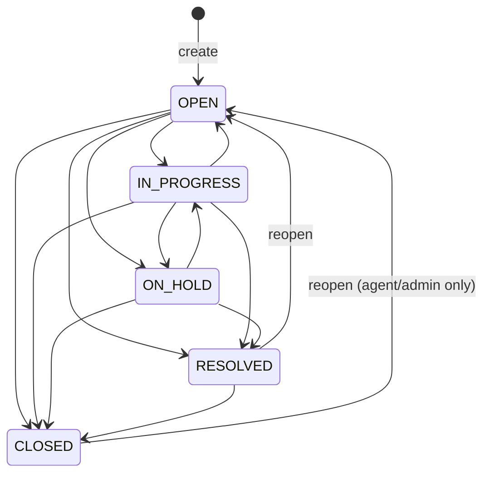

# 03 — Domain & Data Model

> Database: PostgreSQL 16 · Migrations: Flyway (`backend/src/main/resources/db/migration`)

---

## 1. Domain Overview

| Aggregate / Entity | Description | Tenant-owned |
|---|---|---|
| **Organization** | A tenant. Holds the name, the login `slug` and the per-org ticket counter | — (it *is* the tenant) |
| **User** | A person who belongs to one org and has one role | ✔ |
| **Ticket** | The aggregate root: a support request | ✔ |
| **TicketComment** | A PUBLIC reply or an INTERNAL note on a ticket | ✔ |
| **TicketHistory** | An append-only audit entry for ticket changes | ✔ |

## 2. Entity Relationship Diagram



## 3. Ticket Status State Machine



| From \ To | OPEN | IN_PROGRESS | ON_HOLD | RESOLVED | CLOSED |
|---|---|---|---|---|---|
| **OPEN** | — | A | A | A | A, C |
| **IN_PROGRESS** | A | — | A | A | A, C |
| **ON_HOLD** | — | A | — | A | A, C |
| **RESOLVED** | A, C | — | — | — | A, C |
| **CLOSED** | A | — | — | — | — |

`A` = Agent or Org Admin. `C` = Customer who requested the ticket. Any other transition → `409 INVALID_STATUS_TRANSITION`. Asking for the status the ticket already has → `409` too, because it is not a transition.

**Side effects**
- Moving to `RESOLVED` sets `resolved_at = now`.
- Moving to `CLOSED` sets `closed_at = now`. If `resolved_at` is empty, it is set to `now` as well.
- Moving to `OPEN` (reopen) clears `resolved_at` and `closed_at`.
- Every transition writes a `STATUS_CHANGED` history entry.

This lives in `TicketStateMachine`, a pure Java class with no Spring dependencies, so it can be unit-tested exhaustively.

```java
public enum TicketStatus { OPEN, IN_PROGRESS, ON_HOLD, RESOLVED, CLOSED }
public enum TicketPriority { LOW, MEDIUM, HIGH, URGENT }
public enum Role { ORG_ADMIN, AGENT, CUSTOMER }
public enum CommentVisibility { PUBLIC, INTERNAL }
public enum HistoryEventType { CREATED, STATUS_CHANGED, ASSIGNEE_CHANGED, PRIORITY_CHANGED }
```

## 4. Physical Schema — `V1__init_schema.sql`

```sql
CREATE EXTENSION IF NOT EXISTS pg_trgm;

-- ───────────── organizations ─────────────
CREATE TABLE organizations (
    id               UUID         PRIMARY KEY,
    name             VARCHAR(120) NOT NULL,
    slug             VARCHAR(50)  NOT NULL,
    ticket_sequence  BIGINT       NOT NULL DEFAULT 0,
    created_at       TIMESTAMPTZ  NOT NULL,
    updated_at       TIMESTAMPTZ  NOT NULL,
    CONSTRAINT uq_organizations_slug UNIQUE (slug),
    CONSTRAINT ck_organizations_slug CHECK (slug ~ '^[a-z0-9][a-z0-9-]{1,48}[a-z0-9]$')
);

-- ───────────── users ─────────────
CREATE TABLE users (
    id               UUID         PRIMARY KEY,
    organization_id  UUID         NOT NULL REFERENCES organizations (id),
    email            VARCHAR(254) NOT NULL,
    password_hash    VARCHAR(100) NOT NULL,
    full_name        VARCHAR(120) NOT NULL,
    role             VARCHAR(20)  NOT NULL,
    active           BOOLEAN      NOT NULL DEFAULT TRUE,
    last_login_at    TIMESTAMPTZ,
    version          BIGINT       NOT NULL DEFAULT 0,
    created_at       TIMESTAMPTZ  NOT NULL,
    updated_at       TIMESTAMPTZ  NOT NULL,
    CONSTRAINT uq_users_org_email UNIQUE (organization_id, email),
    CONSTRAINT uq_users_org_id    UNIQUE (organization_id, id),   -- target for composite FKs
    CONSTRAINT ck_users_role      CHECK (role IN ('ORG_ADMIN','AGENT','CUSTOMER')),
    CONSTRAINT ck_users_email_lc  CHECK (email = lower(email))
);
CREATE INDEX ix_users_org_role ON users (organization_id, role) WHERE active;

-- ───────────── tickets ─────────────
CREATE TABLE tickets (
    id               UUID         PRIMARY KEY,
    organization_id  UUID         NOT NULL REFERENCES organizations (id),
    number           BIGINT       NOT NULL,
    subject          VARCHAR(200) NOT NULL,
    description      TEXT         NOT NULL,
    priority         VARCHAR(10)  NOT NULL,
    priority_rank    SMALLINT GENERATED ALWAYS AS (
                        CASE priority WHEN 'LOW' THEN 1 WHEN 'MEDIUM' THEN 2
                                      WHEN 'HIGH' THEN 3 WHEN 'URGENT' THEN 4 END) STORED,
    status           VARCHAR(15)  NOT NULL,
    requester_id     UUID         NOT NULL,
    assignee_id      UUID,
    resolved_at      TIMESTAMPTZ,
    closed_at        TIMESTAMPTZ,
    version          BIGINT       NOT NULL DEFAULT 0,
    created_at       TIMESTAMPTZ  NOT NULL,
    updated_at       TIMESTAMPTZ  NOT NULL,
    CONSTRAINT uq_tickets_org_number UNIQUE (organization_id, number),
    CONSTRAINT uq_tickets_org_id     UNIQUE (organization_id, id),
    CONSTRAINT ck_tickets_priority   CHECK (priority IN ('LOW','MEDIUM','HIGH','URGENT')),
    CONSTRAINT ck_tickets_status     CHECK (status IN ('OPEN','IN_PROGRESS','ON_HOLD','RESOLVED','CLOSED')),
    -- Composite FKs: requester/assignee MUST belong to the same organization as the ticket
    CONSTRAINT fk_tickets_requester FOREIGN KEY (organization_id, requester_id) REFERENCES users (organization_id, id),
    CONSTRAINT fk_tickets_assignee  FOREIGN KEY (organization_id, assignee_id)  REFERENCES users (organization_id, id)
);
CREATE INDEX ix_tickets_org_status_created   ON tickets (organization_id, status, created_at DESC);
CREATE INDEX ix_tickets_org_assignee_status  ON tickets (organization_id, assignee_id, status);
CREATE INDEX ix_tickets_org_requester_created ON tickets (organization_id, requester_id, created_at DESC);
CREATE INDEX ix_tickets_org_priority         ON tickets (organization_id, priority_rank DESC);
CREATE INDEX ix_tickets_subject_trgm         ON tickets USING gin (subject gin_trgm_ops);
CREATE INDEX ix_tickets_description_trgm     ON tickets USING gin (description gin_trgm_ops);

-- ───────────── ticket_comments ─────────────
CREATE TABLE ticket_comments (
    id               UUID        PRIMARY KEY,
    organization_id  UUID        NOT NULL,
    ticket_id        UUID        NOT NULL,
    author_id        UUID        NOT NULL,
    body             TEXT        NOT NULL,
    visibility       VARCHAR(10) NOT NULL,
    created_at       TIMESTAMPTZ NOT NULL,
    CONSTRAINT ck_comments_visibility CHECK (visibility IN ('PUBLIC','INTERNAL')),
    CONSTRAINT fk_comments_ticket FOREIGN KEY (organization_id, ticket_id) REFERENCES tickets (organization_id, id),
    CONSTRAINT fk_comments_author FOREIGN KEY (organization_id, author_id) REFERENCES users (organization_id, id)
);
CREATE INDEX ix_comments_ticket_created ON ticket_comments (ticket_id, created_at);

-- ───────────── ticket_history ─────────────
CREATE TABLE ticket_history (
    id               UUID        PRIMARY KEY,
    organization_id  UUID        NOT NULL,
    ticket_id        UUID        NOT NULL,
    actor_id         UUID        NOT NULL,
    event_type       VARCHAR(20) NOT NULL,
    old_value        VARCHAR(100),
    new_value        VARCHAR(100),
    created_at       TIMESTAMPTZ NOT NULL,
    CONSTRAINT ck_history_event CHECK (event_type IN ('CREATED','STATUS_CHANGED','ASSIGNEE_CHANGED','PRIORITY_CHANGED')),
    CONSTRAINT fk_history_ticket FOREIGN KEY (organization_id, ticket_id) REFERENCES tickets (organization_id, id),
    CONSTRAINT fk_history_actor  FOREIGN KEY (organization_id, actor_id)  REFERENCES users (organization_id, id)
);
CREATE INDEX ix_history_ticket_created ON ticket_history (ticket_id, created_at);
```

### 4.1 Design notes
- **Composite foreign keys `(organization_id, x_id)`**: the database itself refuses a ticket in Org A that points to a user in Org B, even if there is a bug in the application. This is a guarantee in the data model, not just an application check. (A nullable `assignee_id` uses `MATCH SIMPLE`, so `NULL` is allowed.)
- **`priority_rank` generated column**: lets you sort by priority in business order (URGENT > HIGH > …) while the column itself stays human-readable. JPA maps it as read-only (`insertable=false, updatable=false`).
- **Enums stored as `VARCHAR` + `CHECK`** rather than ordinals, so adding a value is a safe migration.
- **Per-org ticket number**:
  ```sql
  UPDATE organizations SET ticket_sequence = ticket_sequence + 1
  WHERE id = :orgId RETURNING ticket_sequence;
  ```
  This runs in the same transaction as the ticket insert. The row lock serializes concurrent ticket creation within one org only, which is fine at helpdesk volumes.
- **History values**: for `ASSIGNEE_CHANGED`, `old_value` and `new_value` hold user UUIDs, and the API turns them into display names. For the other event types they hold enum names.
- **No `ON DELETE CASCADE`**: nothing is hard-deleted in v1. Users are deactivated instead.
- **Trigram indexes** make `ILIKE '%term%'` searches fast. They can be added in a later migration (`V3`) if the first version should stay simpler.

## 5. JPA Mapping Sketch

```java
@MappedSuperclass
@EntityListeners(AuditingEntityListener.class)
public abstract class BaseEntity {
    @Id private UUID id = UuidCreator.getTimeOrderedEpoch(); // UUIDv7 → index-friendly
    @CreatedDate  @Column(nullable = false, updatable = false) private Instant createdAt;
    @LastModifiedDate @Column(nullable = false) private Instant updatedAt;
}

@MappedSuperclass
public abstract class TenantOwnedEntity extends BaseEntity {
    @Column(name = "organization_id", nullable = false, updatable = false)
    private UUID organizationId;          // set once from actor; never from request DTO
}

@Entity @Table(name = "tickets")
public class Ticket extends TenantOwnedEntity {
    private Long number;
    private String subject;
    private String description;
    @Enumerated(EnumType.STRING) private TicketPriority priority;
    @Column(insertable = false, updatable = false) private Short priorityRank;
    @Enumerated(EnumType.STRING) private TicketStatus status;
    @ManyToOne(fetch = LAZY, optional = false) @JoinColumn(name = "requester_id") private User requester;
    @ManyToOne(fetch = LAZY) @JoinColumn(name = "assignee_id") private User assignee;
    private Instant resolvedAt, closedAt;
    @Version private long version;

    // Domain behaviour — invariants live here, not in controllers
    public void changeStatus(TicketStatus target, Instant now) { ... }
    public void assignTo(User agent) { ... }   // asserts same org + assignable role
    public void ensureNotClosed() { ... }
}
```

Comments and history are **not** mapped as collections on `Ticket`. Each is read through its own paginated repository, which avoids N+1 queries and loading unbounded collections.

## 6. Migration Plan

| Version | Content | Phase |
|---|---|---|
| `V1__init_schema.sql` | The tables, constraints and indexes above | 1 |
| `V2__…` | Reserved for adjustments found in Phase 4 (search indexes, if they were deferred) | 4 |
| `R__demo_data.sql` *(not used)* | Demo data is seeded with `DemoDataSeeder` under `@Profile("demo")` because passwords must be BCrypt-hashed at runtime | 8 |
| `V9__rls_policies.sql` | Optional Row-Level Security | 9 |
