# 08 — Phased Implementation Plan

> **Status (2026-10-16): Phases 0–8 are implemented and verified.** Phase 9 has not started, apart from the `GET /tickets/stats` stretch endpoint. What was built, the deviations from this plan and the verification evidence are in [10 — Implementation Notes](10-implementation-notes.md).

## 1. Phase Overview

```mermaid
gantt
    dateFormat  X
    axisFormat  Day %s
    section Backend
    P0 Foundations           :p0, 0, 1
    P1 Domain & persistence  :p1, after p0, 1
    P2 Auth & tenancy        :p2, after p1, 1.5
    P3 Org & user mgmt       :p3, after p2, 1
    P4 Ticket core           :p4, after p3, 2
    P5 Comments & history    :p5, after p4, 1
    P6 API docs & hardening  :p6, after p5, 1
    section Frontend
    P7 React UI              :p7, after p3, 3
    section Delivery
    P8 Packaging & handover  :p8, after p6, 1
```

*Phase 7 can start once Phase 3 is done (the auth and user APIs exist), and it can run in parallel with Phases 4–6 if a second developer is available. With one developer, run Phases 0→8 in order.*

| Phase | Name | Effort | Key output |
|---|---|---|---|
| 0 | Foundations & tooling | 0.5–1 d | Skeleton repo, builds, CI green, Postgres in Docker |
| 1 | Domain model & persistence | 1 d | Flyway V1, entities, repositories, persistence tests |
| 2 | Authentication & tenant context | 1.5 d | Register org, login, JWT, security chain, error handling |
| 3 | Organization & user management | 1 d | Admin user CRUD, agents/customers lookups |
| 4 | Ticket management core | 2 d | Create, view, update, assign, status machine, search + pagination |
| 5 | Comments, internal notes & history | 1 d | Comment APIs with visibility, history API |
| 6 | API documentation & hardening | 1 d | OpenAPI, Postman, isolation suite, coverage gate |
| 7 | Frontend | 2.5–3 d | All screens wired to the API |
| 8 | Packaging & delivery | 0.5–1 d | docker-compose full stack, seed data, README, final QA |
| 9 | *(Optional)* Enhancements — not started (except `/tickets/stats`) | — | Refresh tokens, RLS, rate limiting, dashboard, notifications… |

---

## 2. Phase Details

### Phase 0 — Foundations & Tooling
**Goal:** a skeleton where everything runs and tests pass, with nothing yet built on it.

Tasks
- [ ] `git init`. Monorepo layout (`backend/`, `frontend/`, `docs/`, `postman/`). `.gitignore`, `.editorconfig`
- [ ] Spring Initializr: Java 21, Spring Boot 3.5.x, Maven. Dependencies: web, validation, security, oauth2-resource-server, data-jpa, postgresql, flyway, actuator, springdoc-openapi, mapstruct, testcontainers, archunit
- [ ] `application.yml` with profiles `dev`, `test`, `demo`, `prod`. All secrets come from environment variables. `spring.jpa.hibernate.ddl-auto=validate`, `open-in-view=false`
- [ ] `docker-compose.yml` with only the `db` service for now (postgres:16-alpine, healthcheck, volume)
- [ ] Base classes: `BaseEntity`, `TenantOwnedEntity`, `ClockConfig`, `JpaAuditingConfig`
- [ ] `ErrorCode` enum, `ApiException`, and a `GlobalExceptionHandler` skeleton returning `ProblemDetail`
- [ ] JaCoCo plugin (gate disabled until Phase 6). Spotless or Checkstyle (optional)
- [ ] GitHub Actions: `./mvnw -B verify`
- [ ] Vite + React + TS scaffold in `frontend/` with ESLint and Prettier (just a hello page)

Exit criteria: `./mvnw verify` passes. The app starts against the dockerized Postgres. `/actuator/health` returns UP. CI is green.

---

### Phase 1 — Domain Model & Persistence
**Goal:** the schema and entities from [03](03-domain-and-data-model.md), with the database itself enforcing isolation.

Tasks
- [ ] `V1__init_schema.sql` (all tables, CHECKs, composite FKs, indexes)
- [ ] Enums: `Role`, `TicketStatus`, `TicketPriority`, `CommentVisibility`, `HistoryEventType`
- [ ] Entities: `Organization`, `User`, `Ticket`, `TicketComment`, `TicketHistory` (`@Version` where specified, `priorityRank` read-only)
- [ ] Repositories with **org-scoped methods only**, plus `TicketRepository.nextTicketNumber`
- [ ] `TicketStateMachine` (pure Java) + exhaustive parameterized unit tests
- [ ] Domain methods on `Ticket`: `changeStatus`, `assignTo`, `unassign`, `updateDetails`, `ensureNotClosed`
- [ ] Testcontainers base class (`@ServiceConnection`). `FlywayMigrationIT`. Repository tests including the **database-level cross-org foreign key violation** test
- [ ] ArchUnit rules (layering + forbidden `findById` on tenant repositories)

Exit criteria: migrations apply. `ddl-auto=validate` passes. The state machine has 100% branch coverage. The cross-org foreign key test proves the database rejects bad links.

---

### Phase 2 — Authentication & Tenant Context
**Goal:** a secure identity layer. From here on, every request has a trusted `AuthenticatedUser`.

Tasks
- [ ] `JwtTokenService` (NimbusJwtEncoder/Decoder, HS256, claims `sub/org/role/iat/exp/jti/iss`). The app fails to start if `JWT_SECRET` is shorter than 32 bytes
- [ ] `AuthenticatedUser` record, `AuthenticatedUserConverter` (loads the user from the database and checks active + org), `@CurrentUser`
- [ ] `SecurityConfig` per [05 §3.1](05-security-and-multitenancy.md#31-security-filter-chain-sketch): stateless, CSRF off, CORS for the dev origin, ProblemDetail 401/403 handlers
- [ ] `AuthService` + `AuthController`: `register-organization`, `login` (constant-time failure path), `me`
- [ ] `OrganizationService.register` creates the org and its ORG_ADMIN in one transaction. Duplicate slug → 409
- [ ] `GlobalExceptionHandler` completed: validation, malformed JSON, type mismatch, optimistic lock, `DataIntegrityViolation` → mapped codes, and a fallback 500
- [ ] MDC filter (`traceId`, `orgId`, `userId`)
- [ ] Tests: `AuthServiceTest`, `AuthenticatedUserConverterTest`, `AuthControllerWebTest` (validation + 401), and `AuthIT` (register → login → me; same email in two orgs)

Exit criteria: you can register an org, log in, and call `/auth/me` with the token. A deactivated user's token is rejected. All errors come back as ProblemDetail.

---

### Phase 3 — Organization & User Management
**Goal:** admins can manage their own tenant.

Tasks
- [ ] `GET/PATCH /organization`
- [ ] `UserService`: create (lowercase email, BCrypt), list with search and filters (paginated), get, patch (role, active, name, with version check). `LAST_ADMIN` and `SELF_DEACTIVATION` rules
- [ ] `UserController` (`/users`, ORG_ADMIN), `AgentController` (`/agents`, `/customers`)
- [ ] MapStruct `UserMapper`. DTO records: `CreateUserRequest`, `UpdateUserRequest`, `UserSummary`, `UserDetail`, `UserRef`
- [ ] Tests: `UserServiceTest`, web slice tests (403 for agents and customers on `/users`), and isolation cases #10 and #11

Exit criteria: an admin can create agents and customers, who can then log in. An agent gets 403 on `/users`. A Globex admin can't see Acme users (404).

---

### Phase 4 — Ticket Management Core
**Goal:** the full ticket lifecycle (except comments), plus search.

Tasks
- [ ] `TicketAccessPolicy` (`loadVisible`, `requireCan*`, `permissionsFor`) + table-driven unit tests
- [ ] `TicketHistoryRecorder` (`created`, `statusChanged`, `assigneeChanged`, `priorityChanged`) — writes in the same transaction
- [ ] `TicketService` commands: `create` (per-org number, on-behalf-of), `update` (version check, field rules), `assign`, `unassign`, `changeStatus` (+ optional comment hook, wired in Phase 5)
- [ ] `TicketQueryService`: `get` (detail + `allowedTransitions` + `permissions`), `search` via `TicketSpecifications` (always org-scoped, forced `requesterId` for customers), `@EntityGraph` for requester and assignee
- [ ] Sort allow-list + size cap (`SortSanitizer`)
- [ ] `TicketController`: endpoints 12–18 from [04](04-api-design.md#1-endpoint-catalogue), with `Location` headers
- [ ] Tests: `TicketServiceTest` (full list in [07 §2](07-testing-strategy.md#2-unit-tests--important-business-logic)), `TicketControllerWebTest`, `TicketSearchIT`, `TicketNumberConcurrencyIT`, `OptimisticLockingIT`, isolation cases #1–4, #7–9, #12, #14

Exit criteria: the whole lifecycle works through Swagger UI and curl. Every filter and sort works with correct page metadata. All the listed tests are green.

---

### Phase 5 — Comments, Internal Notes & History
**Goal:** the conversation thread and the audit trail.

Tasks
- [ ] `CommentService`: `add` (visibility rules, closed-ticket rule), `list` (visibility filter **in SQL** for customers)
- [ ] `CommentController`: `GET/POST /tickets/{id}/comments`
- [ ] Wire the optional `comment` on `PUT /tickets/{id}/status` (same transaction)
- [ ] `HistoryController`: `GET /tickets/{id}/history` with batched resolution of assignee display names
- [ ] Tests: `CommentServiceTest`, web slice tests, `TicketLifecycleIT`, isolation cases #5, #6, #13

Exit criteria: customers never receive INTERNAL comments (verified at the HTTP level, including `totalElements`). History shows every status, assignee and priority change with actor and timestamp.

---

### Phase 6 — API Documentation & Hardening
**Goal:** a professional API surface and a quality gate.

Tasks
- [ ] springdoc: `OpenApiConfig` (info, `bearerAuth` scheme, servers). `@Tag`, `@Operation` and `@ApiResponse` (including ProblemDetail schemas) on every controller. Request and response examples
- [ ] Export `docs/openapi.yaml`. Build `postman/helpdesk.postman_collection.json` (environment variables, login script that stores `{{token}}`, folders per feature + "Tenant isolation")
- [ ] Complete `TenantIsolationIT` (all 16 cases in [07 §4](07-testing-strategy.md#4-tenant-isolation-integration-suite--tenantisolationit-))
- [ ] Turn on the JaCoCo gate (80% on service, domain and security). Fill any gaps
- [ ] Security pass: run the [05 §4](05-security-and-multitenancy.md#4-secure-coding-checklist-pr-review-gate) checklist on every endpoint. Check that no stack traces leak. Check the security headers
- [ ] Performance smoke test: seed 100k tickets in one org and check that `EXPLAIN ANALYZE` uses the indexes for the main list queries

Exit criteria: Swagger UI fully documents every endpoint and error. The Postman collection runs end-to-end with Newman. `mvn verify` passes with the coverage gate on.

---

### Phase 7 — Frontend
**Goal:** a clean, role-aware UI covering FR-27 and FR-28 (see [06](06-frontend-design.md)).

Tasks (in order)
1. [ ] App shell: MUI theme, `AppLayout`, router, axios client + interceptors, ProblemDetail helpers, generated API types (`openapi-typescript`)
2. [ ] Auth: `AuthProvider`, Login, Register org, `RequireAuth` and `RequireRole`, logout, session-expired handling
3. [ ] Ticket list: table, URL-synced filters (search, status, priority, assignee, unassigned, "assigned to me"), server-side pagination and sort
4. [ ] Create ticket: form with Zod validation. "On behalf of" customer picker for staff
5. [ ] Ticket detail: info panel, edit dialog (version-aware), status dropdown from `allowedTransitions`, assignee picker + "Assign to me", conflict banner on 409
6. [ ] Comments: thread, composer with a Public/Internal toggle (staff only), internal notes styled differently
7. [ ] History timeline tab
8. [ ] Admin: users table + create/edit dialog (role, activate/deactivate), organization settings
9. [ ] Polish: empty, loading and error states, toasts, responsive layout. Vitest tests for filters and the composer

Exit criteria: you can demo every requirement in the UI as admin, agent and customer in both seeded orgs. Lint, typecheck and tests are green.

---

### Phase 8 — Packaging & Delivery
**Goal:** a reviewer clones the repo, runs one command, and sees everything working.

Tasks
- [ ] Backend `Dockerfile` (multi-stage Maven → JRE 21, non-root user). Frontend `Dockerfile` (node build → nginx) + `nginx.conf`
- [ ] Full `docker-compose.yml`: db, backend (`SPRING_PROFILES_ACTIVE=demo`), web on `:3000`. Healthchecks and `depends_on: condition: service_healthy`
- [ ] `DemoDataSeeder` (`@Profile("demo")`, idempotent): **Acme** and **Globex**, each with 1 admin, 2 agents, 3 customers, about 25 tickets in mixed states, comments (public and internal) and history
- [ ] Root `README.md`: overview, architecture diagram, prerequisites, quick start (Docker), local dev (Maven + Vite), demo credentials, API docs links, how to run tests, project structure, design decisions, known limitations
- [ ] Final QA pass against the [traceability matrix](#7-requirements-traceability-matrix). Tag `v1.0.0`. Produce a ZIP if needed (`git archive`)

Exit criteria: on a clean machine, `docker compose up --build` gives a working app at `http://localhost:3000` and Swagger at `http://localhost:8080/swagger-ui.html`, all within 5 minutes.

---

### Phase 9 — Optional Enhancements (prioritized)
1. Refresh tokens (httpOnly cookie, rotation, revocation table) + logout-everywhere
2. PostgreSQL Row-Level Security as a fifth isolation layer
3. Login rate limiting (Bucket4j) + account lockout
4. Dashboard: `GET /tickets/stats` + charts
5. Email notifications on assignment and status changes (domain events → async notifier)
6. Customer self-registration per org
7. Attachments (S3-compatible storage, virus-scan hook)
8. SLA timers and due dates, teams/queues, saved filters

---

## 3. Git & Workflow Conventions
- Branch per phase: `phase/2-auth`, merged to `main` through a PR. The PR must have CI green and the security checklist ticked.
- Conventional Commits (`feat(ticket): add status transitions`, `test(isolation): …`).
- Each phase updates its docs if the design changed. Record a new ADR when a decision changes.

## 4. Definition of Done (every story)
- [ ] Code + unit tests. Integration test where the change crosses the database or HTTP
- [ ] A tenant-isolation test and a role test for any new endpoint
- [ ] OpenAPI annotations updated
- [ ] No new warnings from lint or static analysis. Coverage gate passes
- [ ] Docs updated where behaviour differs from the design

## 5. Milestones
| Milestone | After phase | Demo |
|---|---|---|
| M1 — "Secure skeleton" | 2 | Register, log in and call a protected endpoint via Swagger |
| M2 — "API complete" | 6 | The full ticket lifecycle via Postman, the isolation suite green |
| M3 — "Product complete" | 7 | End-to-end UI demo for all three roles |
| M4 — "Delivered" | 8 | One-command start, README, tagged release |

## 6. Risk Register
| Risk | Impact | Likelihood | Mitigation |
|---|---|---|---|
| A tenant leak from a forgotten org filter | Critical | Medium | Four-layer enforcement, ArchUnit rule, `TenantIsolationIT`, PR checklist |
| Internal notes leaking to customers | High | Medium | Filtered in SQL, an HTTP-level test that also checks `totalElements` |
| Ticket number race conditions | Medium | Medium | Atomic `UPDATE … RETURNING` + concurrency IT |
| Scope creep (SLAs, emails, attachments) | Medium | High | Out-of-scope list in [01 §7](01-requirements.md#7-out-of-scope-v1). Phase 9 backlog |
| The frontend taking longer than estimated | Medium | Medium | Stick to MUI defaults. Backend-driven permissions keep UI logic thin |
| Dependency version churn (Boot 3.5 vs 4.x) | Low | Medium | Pin versions. Commit the Maven wrapper. ADR-002 notes the upgrade path |

## 7. Requirements Traceability Matrix
| Req | Design reference | Phase | Verified by |
|---|---|---|---|
| FR-1, FR-5 | 04 §3.1, 05 §3 | 2 | `AuthServiceTest`, `AuthIT` |
| FR-2 | 05 §2.1, 04 §4 | 2–5 | Web slice role tests |
| FR-3, BR-8, BR-9 | 04 §3.3 | 3 | `UserServiceTest` |
| FR-4 | 05 §2.1 | 2 | `AuthenticatedUserConverterTest` |
| FR-6 | 04 §3.1 | 2 | `AuthIT` |
| FR-7, FR-9, BR-1 | 05 §2, 03 §4.1 | 1–6 | `TenantIsolationIT` #1–16, ArchUnit |
| FR-8 | 04 §3.2 | 3 | Web slice test |
| FR-10, FR-11, BR-2 | 04 §3.4, 03 §4 | 4 | `TicketServiceTest`, `TicketNumberConcurrencyIT` |
| FR-12, FR-19 | 05 §2.3 | 4 | Isolation #12, `TicketServiceTest` |
| FR-13, BR-3 | 04 §3.4 PATCH | 4 | `TicketServiceTest`, `OptimisticLockingIT` |
| FR-14, BR-10 | 04 §3.4 assignee | 4 | `TicketServiceTest`, isolation #9 |
| FR-15, BR-4, BR-5, BR-6 | 03 §3 | 1, 4 | `TicketStateMachineTest`, `TicketLifecycleIT` |
| FR-16, FR-17, FR-18 | 04 §3.4 search | 4 | `TicketSearchIT` |
| FR-20, FR-21 | 04 §3.5 | 5 | `CommentServiceTest`, isolation #13 |
| FR-22, FR-23, BR-7 | 04 §3.6 | 4–5 | `TicketLifecycleIT` |
| FR-24 | 04 §5 | 6 | Swagger UI, Newman run |
| FR-25, FR-26 | 04 §2.4–2.5 | 2, 6 | Web slice tests |
| FR-27, FR-28 | 06 | 7 | Manual demo script, Vitest |
| NFR-1…9 | 02 §6, 05 | all | CI, JaCoCo, perf smoke test (Phase 6) |
