# 11 — User Guide (with Screenshots)

> A walkthrough of the web app for each role, using the `demo` seed data (organizations **Acme** and **Globex**, password `Password123!`).
> Screenshots were taken from the running application on 2026-10-16 and are stored in [`docs/images/`](images/).

---

## 1. Signing in and registering

### Sign in
Enter the **organization slug**, email and password. Emails are only unique within an organization, so the same email can exist in Acme and Globex as two separate users (BR-9). The **Demo accounts** box fills the form with one click.

Any failure (unknown organization, unknown email, wrong password or deactivated account) shows the same message, so nobody can probe which accounts exist (FR-1).

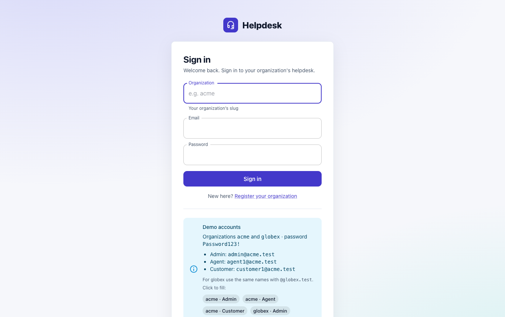

### Register a new organization
Anyone can create a new organization. The person registering becomes its first **Org Admin** and is signed in straight away (FR-6). The slug is used to sign in and cannot be changed later (FR-8).

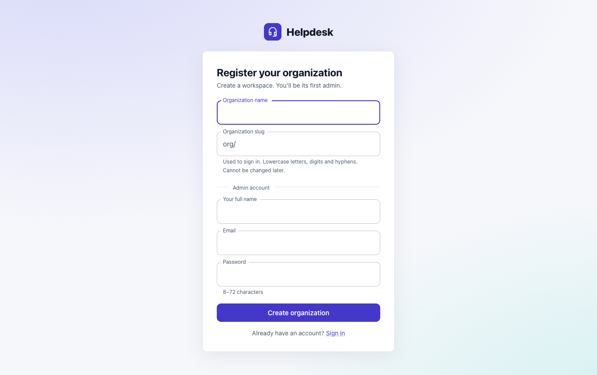

## 2. Agent — working the queue

### Ticket list
Agents and admins see **every ticket in their organization**. The strip at the top shows live counters (`GET /tickets/stats`). Search matches subject and description, or a number like `#21`. Status and priority accept several values. Assignee can be *Anyone*, *Unassigned*, *Me* or a specific agent.

All filters, the sort and the page are kept in the URL, so a filtered view can be bookmarked and shared (FR-16 – FR-18).

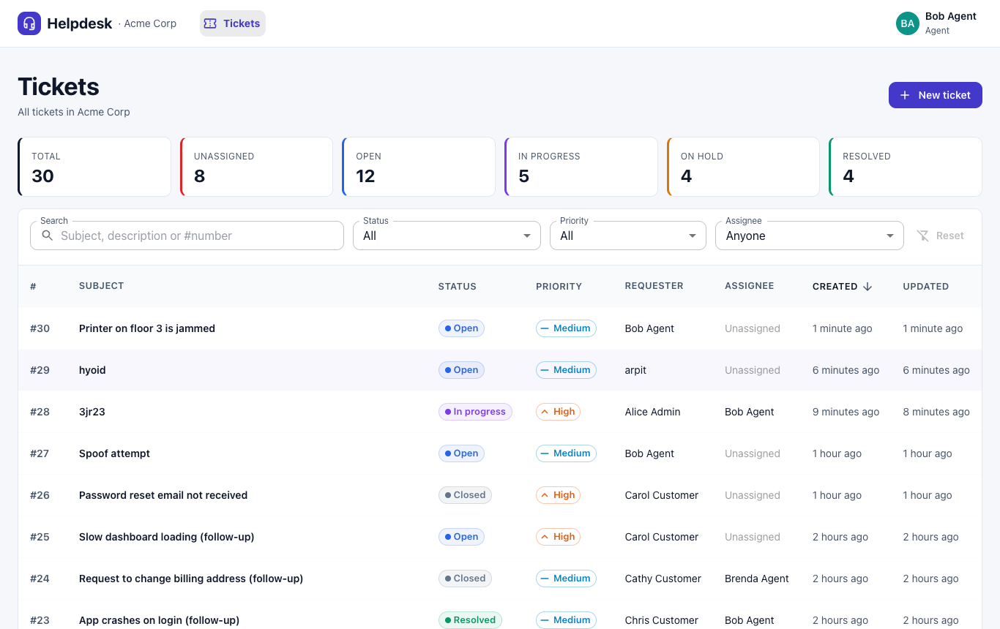

### Ticket detail
The left side shows the conversation. **Internal notes** have a yellow background and a lock badge, and customers never see them (FR-21). The right panel holds the actions: status, priority, assignee (including **Assign to me**) and the timestamps. The panel only shows what the backend says this user may do (`permissions` in the API response).

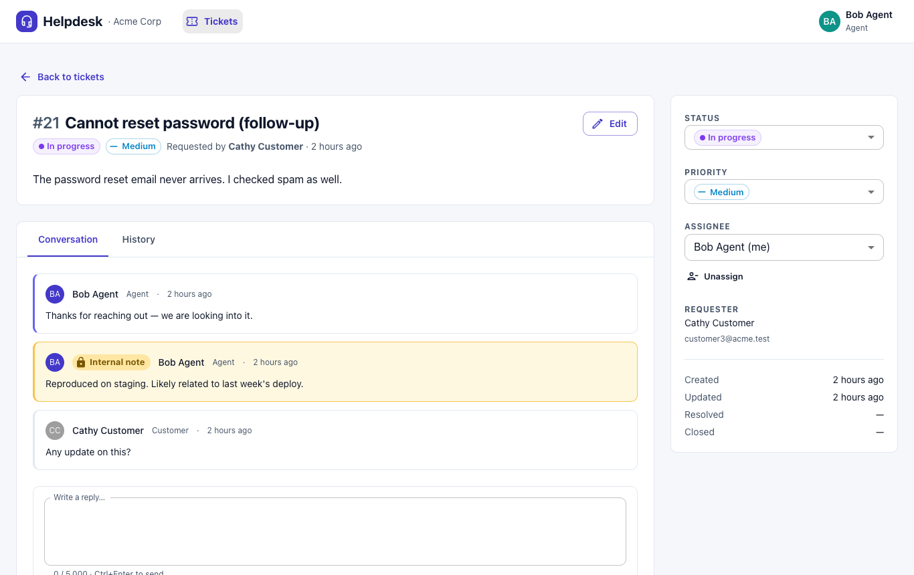

### Changing status
The status menu offers **only the transitions allowed** for this user from the current status ([state machine](03-domain-and-data-model.md#3-ticket-status-state-machine)). Moving a ticket to *Resolved* or *Closed* can include a public comment, saved together with the change.

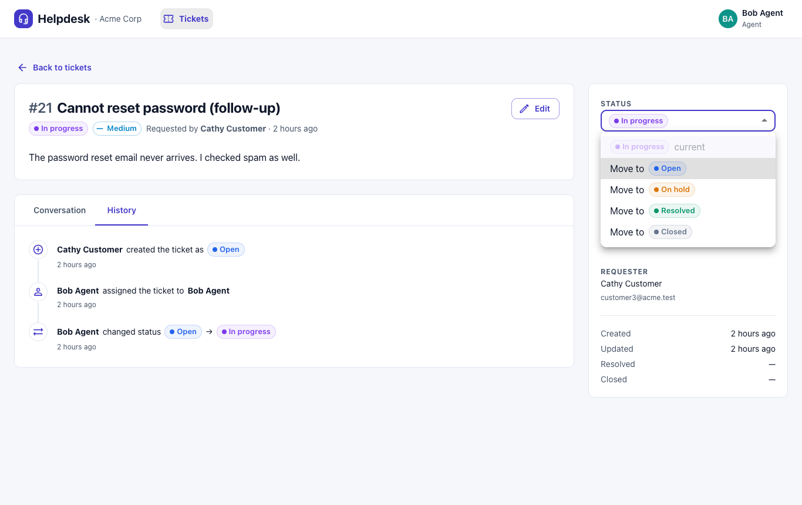

### History
Every creation, status change, assignment and priority change is recorded with who made it and when (FR-22). Customers can see the history of their own tickets.

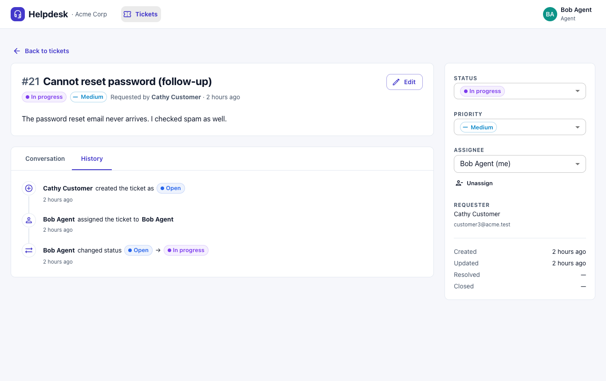

### Creating a ticket
Subject and description are required, and priority defaults to *Medium*. Staff can raise a ticket **on behalf of a customer** with the search field at the top. Leave it empty to raise the ticket as yourself.

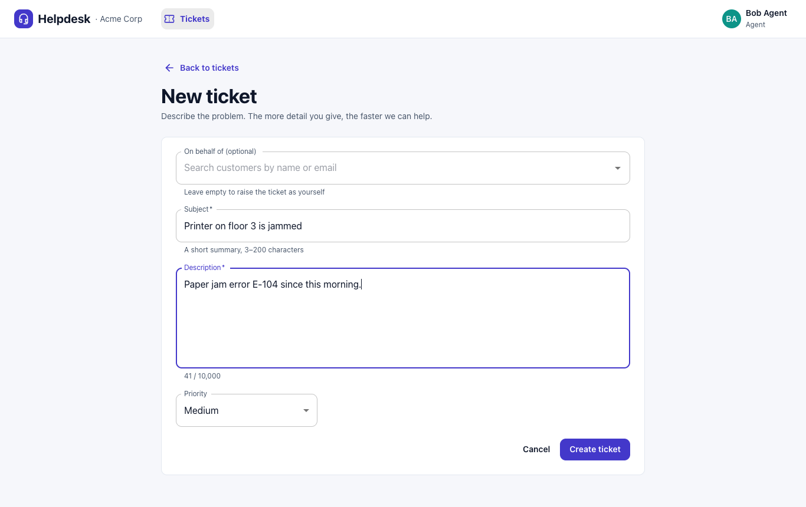

After saving, the new ticket opens and a confirmation appears at the bottom. It closes on its own after a few seconds, or right away with ✕.

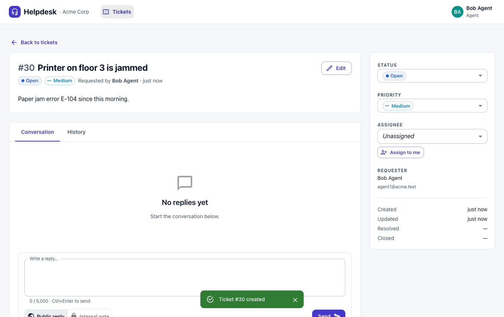

## 3. Customer — own tickets only

Customers see **only the tickets they raised** ("My tickets"). The server enforces this whatever filters are sent (FR-19). The assignee filter is hidden.

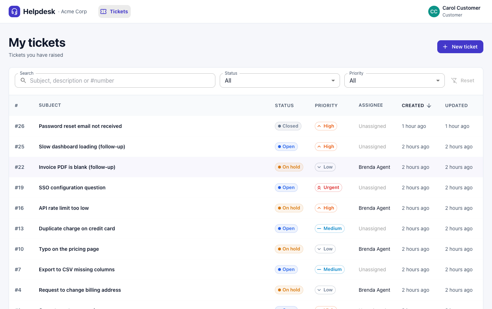

On a ticket, customers see public replies only. They cannot change priority or assignment. They can **close** their own ticket, and **reopen** it while it is *Resolved* (BR-4). A *Closed* ticket is read-only (BR-6): the reply box is replaced by a notice.

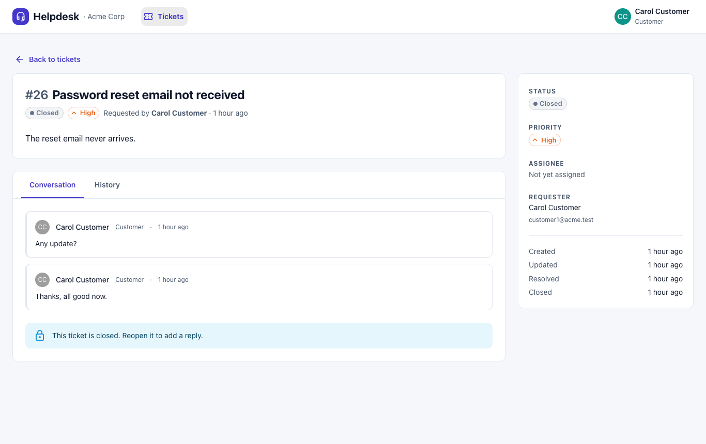

## 4. Org Admin — users and organization

### Users
Admins can search and filter users, create agents, customers or other admins, change their role, and activate or deactivate them (FR-3). Users are never deleted. A deactivated user's existing token stops working on their next request (FR-4).

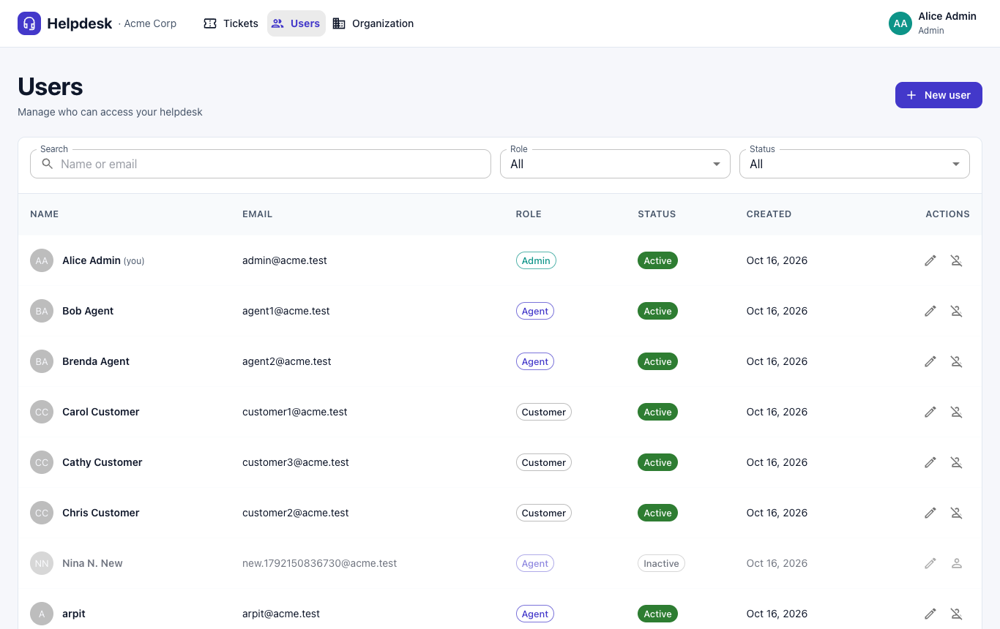

The edit dialog changes name, role and active status. The email cannot be changed. The organization must always keep at least one active admin, and an admin cannot deactivate their own account (BR-8).

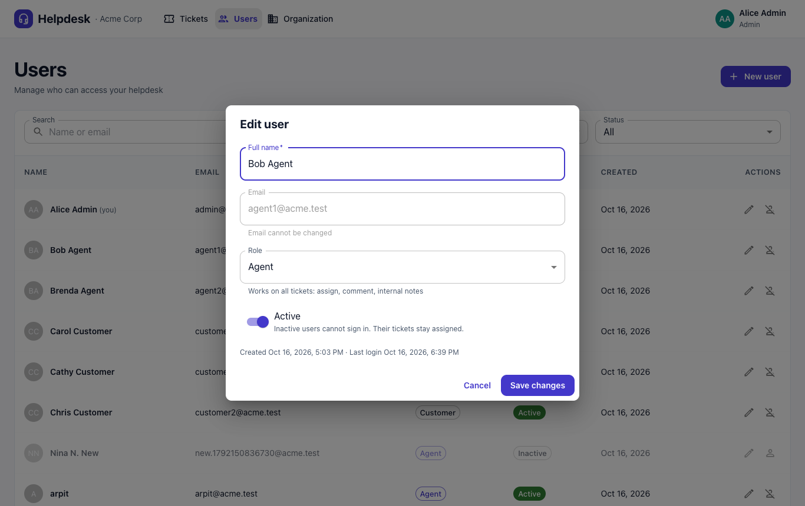

### Organization settings
The organization can be renamed. The slug is shown but read-only.

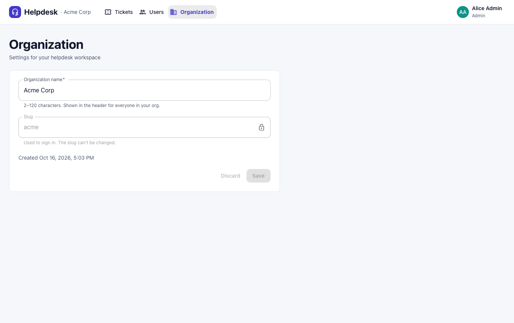

## 5. Tenant isolation, seen from the UI

Here a **Globex** admin opens the URL of an **Acme** ticket. The API answers `404`, and the UI shows "Ticket not found". It never says "forbidden", so nobody can even confirm that the ticket exists (FR-9, ADR-004). The same applies to a customer opening another customer's ticket.

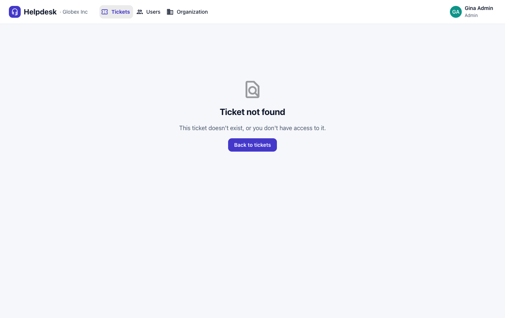

## 6. API documentation (Swagger UI)

The interactive API docs are at `http://localhost:8080/swagger-ui.html`. Call `POST /api/v1/auth/login`, click **Authorize**, and paste the `accessToken`. Every endpoint documents its request, response and error format (RFC 7807 `Problem`).

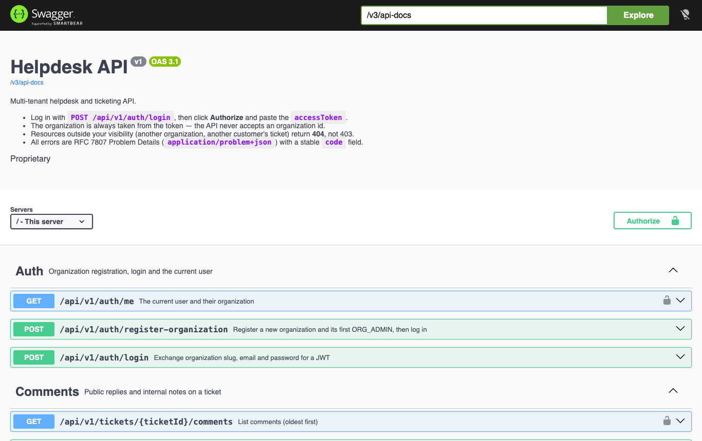

---

### Refreshing the screenshots
With the app running on the `demo` profile, take new screenshots at a 1366 × 860 viewport and save them under `docs/images/` with the same file names. The guide then picks them up without any change.
